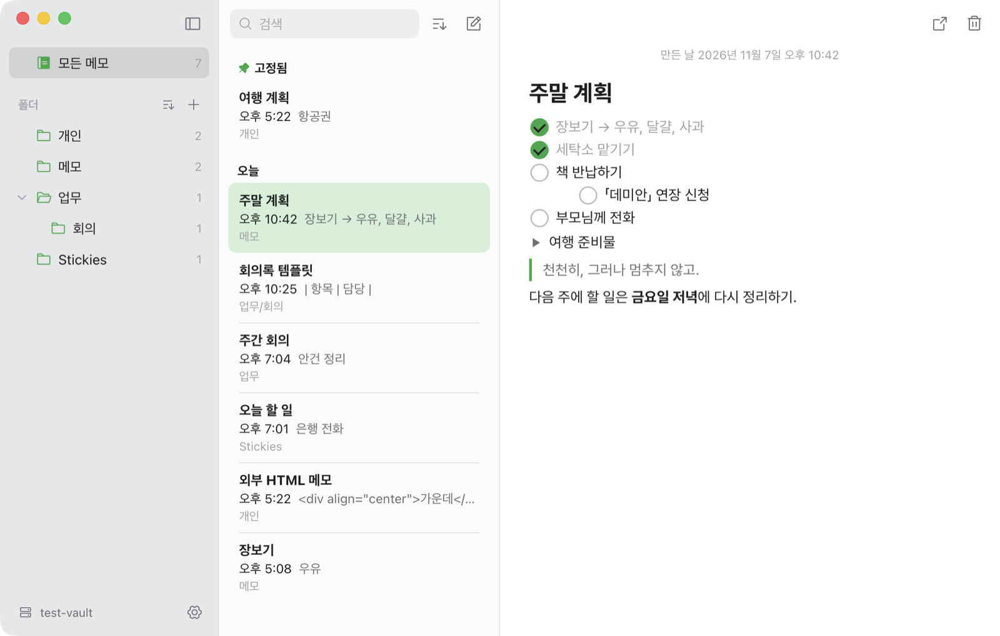

<div align="center">


# Modoit

**쓴 메모를 그대로 바탕화면에 붙여 두는 Mac 메모 앱. 저장은 내 폴더의 .md 파일로.**

익숙한 3단 화면 · Notion처럼 빠른 단축 입력 · 계정·클라우드·추적 없음


<br/>

<picture>
  <source media="(prefers-color-scheme: dark)" srcset="docs/images/screenshot-dark.png">
  
</picture>

<sub>GitHub를 다크 모드로 보면 다크 화면이 보입니다.</sub>

</div>

<br/>

## 📦 설치

**Homebrew (추천)**

```bash
brew install --cask reentakim/tap/modoit
```

업데이트는 `brew upgrade --cask modoit`으로 합니다.

**직접 받기**: [Releases](https://github.com/ReentaKim/Modoit/releases/latest)에서 `Modoit-x.y.z.dmg`를 받아 Modoit을 응용 프로그램 폴더로 옮깁니다.

<details>
<summary><b>처음 열 때 "확인되지 않은 개발자" 경고가 뜨면</b></summary>

<br/>

Modoit은 Apple 공증을 받지 않은 개인 프로젝트입니다. 소스가 모두 공개돼 있고 [직접 빌드](#-직접-빌드하기)할 수도 있습니다. Homebrew로 설치하면 이 경고가 뜨지 않습니다.

- **macOS 15 이상**: 한 번 열어 경고를 닫은 뒤 **시스템 설정 › 개인정보 보호 및 보안**에서 맨 아래 **"그래도 열기"**를 누릅니다.
- 또는 터미널에서 한 줄:
  ```bash
  xattr -dr com.apple.quarantine /Applications/Modoit.app
  ```

</details>

macOS 15 Sequoia 이상, Apple Silicon·Intel 모두 지원합니다(Intel Mac에서는 아직 실행해 보지 못했습니다). v0.x를 쓰던 분은 그대로 덮어 설치하면 저장 폴더와 설정을 이어 씁니다. 첫 실행 때 메모를 저장할 폴더를 고릅니다.

## ✦ 무엇이 다른가요

<table>
<tr>
<td width="50%" valign="top">

### 📌 메모 = 스티키
메모를 따로 옮겨 적지 않고 **그 메모 자체를** 바탕화면에 꺼내 둡니다.
- ⌘⇧S로 꺼내기 ↔ 다시 넣기
- 스티키에서는 **보고 체크만**, 글은 두 번 눌러 메인 창에서
- 색, 위치, 크기를 기억해 같은 자리에 다시 뜸
- 다른 앱을 쓰는 중에도 포커스를 뺏지 않는 macOS 패널
- 10개를 띄워도 가벼움 (메인 창 포함 약 150 MB)

</td>
<td width="50%" valign="top">

### 📁 내 폴더, 순수 Markdown
처음 실행할 때 저장 폴더를 고르면 그 안에 `.md` 파일로 저장합니다.
- Finder, Git, iCloud, 다른 편집기에서 그대로 열림
- 폴더 = 실제 디렉터리 (계층·끌어 옮기기)
- 이미지는 `attachments/`에, 링크는 앱이 관리
- 지원하지 않는 서식은 **읽기 전용**으로 열어 원본 보호

</td>
</tr>
<tr>
<td width="50%" valign="top">

### ⌨️ Notion처럼 빠르게
줄 맨 앞에서 기호만 치면 블록이 됩니다. `/`를 누르면 메뉴가 열립니다.
- 체크박스, 목록, 토글, 인용, 제목, 코드, 이미지
- Tab / ⇧Tab 들여쓰기
- `->` → `→` 자동 변환

</td>
<td width="50%" valign="top">

### 🎨 내 취향대로
- 라이트 / 다크 / 시스템 설정 따르기
- 강조 색 8가지
- 글꼴: 시스템, Pretendard, 명조, 고정폭, 직접 입력
- 본문 크기 14 ~ 22px, 사이드바 접기

</td>
</tr>
</table>

## ⌨️ 단축 입력

| 입력 | 결과 | | 입력 | 결과 |
|:---:|---|---|:---:|---|
| `- ` | • 점 목록 | | `> ` | ▸ 토글 (접어 두기) |
| `1. ` | 1. 번호 목록 | | `\| ` | ┃ 인용 |
| `[ ] ` | ◯ 체크박스 | | `->` `<-` | → ← |
| `# ` `## ` `### ` | 제목 1 · 2 · 3 | | `/` | 명령 메뉴 |
| `---` | 구분선 | | Tab · ⇧Tab | 들여쓰기 · 내어쓰기 |

<details>
<summary><b>키보드 단축키 전체 보기</b></summary>

<br/>

| 단축키 | 동작 |
|---|---|
| ⌘N | 새 메모 |
| ⌘⇧N | 새 메모를 스티키로 띄우고 메인 창에서 쓰기 |
| ⌘⇧S | 스티키로 꺼내기 ↔ 다시 넣기 |
| ⌘⇧P | 즐겨찾기 |
| ⌥⌘N | 새 폴더 |
| ⌥⌘S | 사이드바 보기·가리기 |
| ⌘F | 검색 |
| ⌘, | 설정 (모양, 강조 색, 글꼴) |
| ⌘0 | 메인 창 다시 보기 |

단축키는 한글·영문 입력 상태와 상관없이 동작합니다.

</details>

## 🗂 저장 구조

```text
내 저장 폴더/
├── 메모/
│   └── 장보기.md          ← 일반 Markdown. 첫 줄이 제목이자 파일 이름
├── 업무/
│   └── 회의/
│       └── 주간 회의.md
├── attachments/            ← 붙여 넣은 이미지
└── .modoit/layout.json     ← 사이드바 순서·구분선 (앱 전용)
```

즐겨찾기에 넣거나 스티키로 꺼낸 메모에만 맨 위에 짧은 frontmatter가 붙습니다. 사용자가 원래 써 둔 키는 건드리지 않습니다.

```yaml
---
pinned: true
sticky: {color: yellow, x: 1250, y: 140, w: 280, h: 280, onTop: false, open: true}
---
```

토글은 GitHub와 Obsidian에서도 접혀 보이도록 `<details>`로 저장합니다.

## 🛠 직접 빌드하기

**필요한 것**: macOS 15 이상, Xcode 16 이상(Swift 6), [Node.js](https://nodejs.org) 20 이상

```bash
npm install
macos/build-app.sh && open macos/build/Modoit.app   # 개발판 (앱 ID가 .dev라 정식판 설정을 건드리지 않음)
macos/make-dmg.sh                                   # 배포판 dmg → macos/build/Modoit-x.y.z.dmg
```

테스트

```bash
swift test --package-path macos       # 파일·폴더·frontmatter·목록 처리
macos/selftest.sh                     # 실제 앱을 임시 폴더에서 조작해 검사
npx tsc --noEmit && npx vitest run    # 편집기 (TipTap)
```

<details>
<summary><b>기술 구성</b></summary>

<br/>

| 영역 | 사용 |
|---|---|
| 앱 | Swift 6, SwiftUI + AppKit, macOS 전용 — 스티키는 NSPanel |
| 메인 편집기 | TipTap 3 + `@tiptap/markdown` (WKWebView 안) |
| 스티키 | NSTextView로 Markdown 원문을 그대로 그림. 표·코드 블록·이미지가 든 메모만 TipTap |
| 기호 · 글꼴 | SF Symbols, Pretendard |
| 파일 처리 | 원자적 쓰기, 파일 감시(FSEvents), 휴지통 이동. 외부 라이브러리는 [Yams](https://github.com/jpsim/Yams) 하나 |

```text
macos/
├── Sources/ModoitCore/   저장 폴더 — 목록, 읽기·쓰기, 이동과 링크 재작성, frontmatter (Foundation만)
├── Sources/ModoitKit/    화면 없는 앱 로직 — 편집 세션, 목록 묶기·정렬
├── Sources/Modoit/       화면 — 메인 창, 스티키, 설정, 메뉴
├── editor-host/          TipTap 편집기를 WKWebView에 싣는 연결부
└── Tests/
src/editor/, src/lib/     TipTap 확장과 Markdown 안전성 검사 (v0.x와 같이 씀)
src/, src-tauri/          v0.x(Tauri) 앱
```

</details>

## 📚 개발 문서

AI가 초안을 쓰고 사람이 검토·결정하는 방식으로, 필요한 산출물만 살아 있는 문서로 관리합니다. → [`docs/`](docs/README.md) · [운영 모델](docs/operating-model.md)

| 알고 싶은 것 | 문서 |
|---|---|
| 제품 사양 (문제·정책·요구사항·마일스톤) | [Brief](docs/product/brief.md) |
| 결정과 이유 | [결정 기록](docs/decisions.md) |
| 기능별 명세 | [기능 카드](docs/product/features/) |
| 구조 | [아키텍처](docs/dev/architecture.md) · [v2 아키텍처](docs/dev/architecture-v2.md) |
| v0.x 문서 (PRD, 디자인 명세, QA 보고서) | [보관](docs/archive/v0.x/) |

## 🗺 버전 기록

| 버전 | 내용 |
|---|---|
| **v2.0** | Swift 네이티브로 다시 만듦: 가벼운 스티키(보기 전용), macOS 기본 화면, 즐겨찾기, 다시 켜면 보던 메모 그대로 — [릴리스 노트](docs/releases/v2.0.md) |
| v0.4 | 어떻게 종료해도(Dock 종료·로그아웃 포함) 마지막 입력을 저장 |
| v0.3 | 다크 모드, 강조 색, 만든 날·고친 날, `>` 토글, `\|` 인용, 화살표 변환, 두 창 동시 편집 병합 |
| v0.2 | 폴더 계층·구분선, 메모를 스티키로 꺼내기, 이미지·표, `/` 메뉴, 고정, 글꼴 설정, 메뉴 막대 |
| v0.1 | 3단 메모 화면, 스티키, Notion식 단축 입력, 저장 폴더 선택 |

## 🤔 다른 메모 앱과 무엇이 다른가요

| | Modoit | Apple 메모 | 스티커(Stickies) | Obsidian | Bear | Notion |
|---|:---:|:---:|:---:|:---:|:---:|:---:|
| 메모를 바탕화면 스티키로 | ✅ | — | ✅ (메모함 없음) | — | — | — |
| 내 폴더의 `.md` 파일로 저장 | ✅ | — | — | ✅ | — | — |
| Notion식 단축 입력 | ✅ | 일부 | — | 일부 | 일부 | ✅ |
| 계정·구독 없음 | ✅ | iCloud | ✅ | ✅ | 구독 | 계정 |
| 모바일·동기화 | — | ✅ | — | ✅ (동기화 유료) | ✅ | ✅ |

Modoit은 **Mac 한 대에서, 파일로 소유하는 메모**를 위한 앱입니다. 모바일·동기화·협업이 필요하다면 다른 앱이 더 맞습니다. 저장 폴더를 iCloud Drive 안에 두면 여러 Mac에서 볼 수는 있습니다.

## 🔒 개인정보

Modoit은 인터넷에 연결하지 않습니다. 계정도, 분석 도구도, 업데이트 확인도 없습니다. 메모는 고른 폴더 안에만 있습니다.

## 📄 라이선스

[MIT](LICENSE) — 자유롭게 쓰고, 고치고, 나눠도 됩니다. 단, **Modoit 이름과 앱 아이콘은 라이선스 대상이 아닙니다.**
번들 글꼴 Pretendard는 [SIL OFL 1.1](licenses/Pretendard-OFL.txt)을 따릅니다. 그 밖의 오픈소스(Phosphor Icons, TipTap, Tauri 등)는 [THIRD_PARTY_NOTICES.md](THIRD_PARTY_NOTICES.md)에 있습니다.

개인 프로젝트라 이슈 답변이 늦을 수 있습니다. 글이 사라지거나 파일이 바뀌는 문제는 가장 먼저 봅니다.

<div align="center">
<br/>
<sub>Made for macOS · 메모는 언제나 내 폴더에</sub>
</div>
