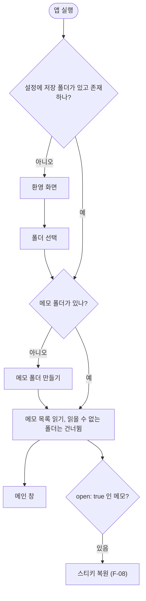
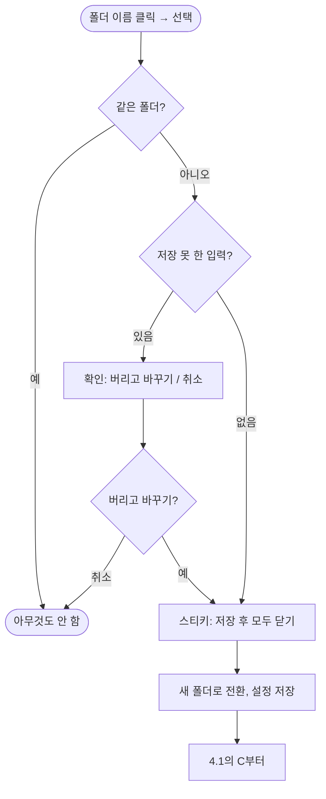

# F-01 저장 폴더

| 항목 | 내용 |
|---|---|
| 담당 | 기획 (검토: 디자인, 개발, QA) |
| 상태 | **초안** |
| 대상 버전 | v2.0 |
| 화면 | [프로토타입](../../prototype/index.html) SCR-01 환영 화면, SCR-02-A 사이드바 아래 |

## 1. 왜
메모가 어디에 있는지 사용자가 정하고, 그 폴더가 곧 앱의 전부다(Brief 3.1). v0.3 사용자는 쓰던 폴더를 그대로 연다(US-6).

## 2. 요구사항
| ID | 약속 | MoSCoW | 수용 기준 | 검증 |
|---|---|---|---|---|
| FR-01 | 첫 실행 때 저장 폴더를 고른다 | Must | 저장 폴더가 없거나 사라졌으면 환영 화면과 "저장 폴더 선택". 고르면 메인 화면으로 | M1 |
| FR-02 | 저장 폴더를 바꾼다 | Must | 사이드바 아래 폴더 이름으로 다시 고른다. 재실행해도 유지. 스티키는 모두 닫힌다. 저장 못 한 입력이 있으면 "버리고 바꾸기 / 취소" | A1, A2, A3 |
| FR-03 | 기본 폴더 "메모" | Should | 빈 폴더를 고르거나 `메모/`가 없으면 만든다 | A4 |

## 3. 규칙
| # | 규칙 | 이유 |
|---|---|---|
| R-1 | v0.3 저장 폴더는 변환 없이 연다 | Brief 3.6 |
| R-2 | 같은 폴더를 다시 고르면 아무 일도 하지 않는다 | |
| R-3 | 바꾸기 전에 모든 스티키의 입력을 저장한 뒤 닫는다 | 입력 보호(BUG-09) |
| R-4 | 설정 파일이 깨져도 저장 폴더 경로는 잃지 않는다 | 다시 고르게 하지 않는다 |

## 4. 동작
### 4.1 앱 시작

### 4.2 저장 폴더 바꾸기

## 5. 검증
| ID | 무엇을 | 어디서 |
|---|---|---|
| A1 | 설정이 깨져도 저장 폴더 유지 | Rust `config` 테스트 `broken_prefs_do_not_lose_vault`, `v01_config_keeps_vault`, `missing_or_broken_file_gives_default` |
| A2 | 저장 못 한 세션이 있을 때 폴더 변경 | `src/qa/v03App.test.tsx` "release된 세션과 저장 폴더 변경", `src/qa/v03Fix.test.tsx` BUG-40 |
| A3 | 저장 폴더 밖 접근 차단 | Rust `rejects_escaping_paths`, `rejects_symlink_escape`, `internal_paths` |
| A4 | 기본 폴더, 읽을 수 없는 폴더 | Rust `create_note_makes_default_folder`, `tree_skips_unreadable_folder` |
| M1 | 첫 실행 → 폴더 선택 → 메인 화면, v0.3 폴더 열기 | 수동 |
