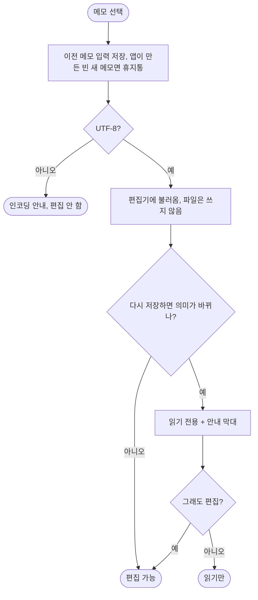

# F-06 편집기

| 항목 | 내용 |
|---|---|
| 담당 | 기획 (검토: 디자인, 개발, QA) |
| 상태 | **확정** (2026-11-12, D-29) |
| 대상 버전 | v2.0 |
| 화면 | [프로토타입](../../prototype/index.html) SCR-02-C, SCR-03, SCR-04 |

> **검토 요청:** 없음.

## 1. 왜
Notion처럼 키보드에서 손을 떼지 않고 서식을 넣는다(US-2). 그러면서도 파일은 표준 Markdown이다.

## 2. 요구사항
| ID | 약속 | MoSCoW | 수용 기준 | 검증 |
|---|---|---|---|---|
| FR-13 | 단축 입력 | Must | 4.1 표 | A1 |
| FR-14 | Tab / Shift+Tab | Must | 목록·체크박스는 단계 이동. 밖에서는 전각 공백 2개. 여러 문단 선택이면 문단마다. 포커스가 빠지지 않는다 | A1 |
| FR-15 | 체크박스 | Must | 누르면 체크·해제, 체크되면 흐리게. 파일에는 `- [x]` | A1 |
| FR-23 | 기본 글자 크기 | Must | 본문 17, 첫 줄 26, 스티키 16 (디자인 토큰에서 pt로 확정) | M1 |
| FR-32 | 이미지 넣기 | Must | 붙여넣기, 끌어 놓기, `/이미지`. 4.3 | A2 |
| FR-33 | 이미지 링크 유지 | Must | 메모·폴더를 옮겨도 보인다. 경로의 `#`·`?`·공백도 | A2 |
| FR-34 | `/` 메뉴 | Must | 빈 줄·공백 뒤 `/`. 텍스트, 제목 1~3, 점·번호 목록, 체크박스, 인용, 코드, 구분선, 이미지, 토글. 한글로 거르기(`/체크`), ↑↓·Enter·Esc | A3 |
| FR-43 | 지원하지 않는 서식 보호 | Must | 다시 저장하면 의미가 바뀌는 서식이 있으면 읽기 전용 + 안내 막대. "그래도 편집"으로만 편집 | A4 |
| FR-48 | 토글 | Must | `> ` 또는 `/토글`. 삼각형으로 접고 편다. `<details><summary>`로 저장. 열 때 항상 접힘 | A5 |
| FR-49 | 화살표 | Must | `->` → `→`, `<-` → `←`. 직후 Backspace로 되돌림. 코드 안에서는 안 바꿈 | A5 |
| FR-50 | 인용 `\|` | Must | 줄 맨 앞 `\| ` → 인용. 파일에는 `> ` | A5 |

## 3. 규칙
| # | 규칙 | 이유 |
|---|---|---|
| R-1 | 입력 규칙(4.1, 4.2)은 메인 편집기와 스티키(두 방식)가 같은 결과를 낸다 | 어느 창에서나 같은 손버릇 |
| R-2 | 메모를 열기만 해서는 쓰지 않는다 | Brief 3.4 |
| R-3 | 표와 Modoit 형식 토글(짝이 맞는 `<details>`)만 지원하는 HTML이다. 코드 안의 `</details>`는 경계로 보지 않는다 | BUG-41, 46, 47 |
| R-4 | 문서 첫 블록이 구분선이면 `***`로 저장한다 | frontmatter로 읽히지 않게(BUG-31) |
| R-5 | 이미지는 `저장폴더/attachments/날짜시각-임의값.확장자`에 복사하고 메모 기준 상대 링크로 넣는다. 20 MB 초과는 거절 | 원본을 건드리지 않고 한곳에 모은다 |
| R-6 | UTF-8이 아니면 목록에는 보이고, 열면 "지원하지 않는 인코딩" 안내, 편집하지 않는다 | BUG-19 |

## 4. 동작
### 4.1 단축 입력 (줄 맨 앞)
| 입력 | 결과 | 파일 |
|---|---|---|
| `- ` `* ` | 점 목록 | `- ` |
| `1. ` | 번호 목록 | `1. ` |
| `[ ] ` `[] ` | 체크박스 | `- [ ] ` |
| `[x] ` | 체크된 체크박스 | `- [x] ` |
| `# ` `## ` `### ` | 제목 1~3 | `#`~`###` |
| `\| ` | 인용 | `> ` |
| `> ` | 토글 | `<details><summary>` |
| ```` ``` ```` | 코드 블록 | 펜스 |
| `---` | 구분선 | `---` (문서 첫 블록이면 `***`) |

### 4.2 글자 안 변환
`->` → `→`, `<-` → `←`. 바로 Backspace면 원래 글자. 코드 안에서는 바꾸지 않는다.

### 4.3 메모 열기


## 5. 검증
| ID | 무엇을 | 어디서 |
|---|---|---|
| A1 | 단축 입력, Tab, 체크박스 | `src/qa/editorFeatures.test.tsx`, `src/qa/logic.test.ts` (스티키는 보기 전용이라 비교 테스트가 필요 없다, D-25) |
| A2 | 이미지 저장·링크 | `src/qa/editorFeatures.test.tsx` FR-32, `src/qa/logic.test.ts` assetUrl, Rust `save_attachment_checks_and_link`, `rewrite_links_unit` |
| A3 | `/` 메뉴 | `src/qa/editorFeatures.test.tsx` FR-34 |
| A4 | 읽기 전용 판정, 열기만 해서는 안 씀 | `src/qa/logic.test.ts` FR-43 / BUG-01, `src/qa/v03Editor.test.tsx` BUG-29, `src/qa/openNoWrite.test.tsx` |
| A5 | 토글·화살표·인용 | `src/qa/v03Editor.test.tsx` FR-48·49·50, `src/qa/v03Fix.test.tsx` maskCode |
| A6 | 인코딩 | `src/qa/appRace.test.tsx` BUG-19, Rust `tree_non_utf8_is_listed_unreadable` |
| M1 | 한글 입력 소스로 단축 입력·화살표 | 수동 (v0.3 G-6), G-14 |
