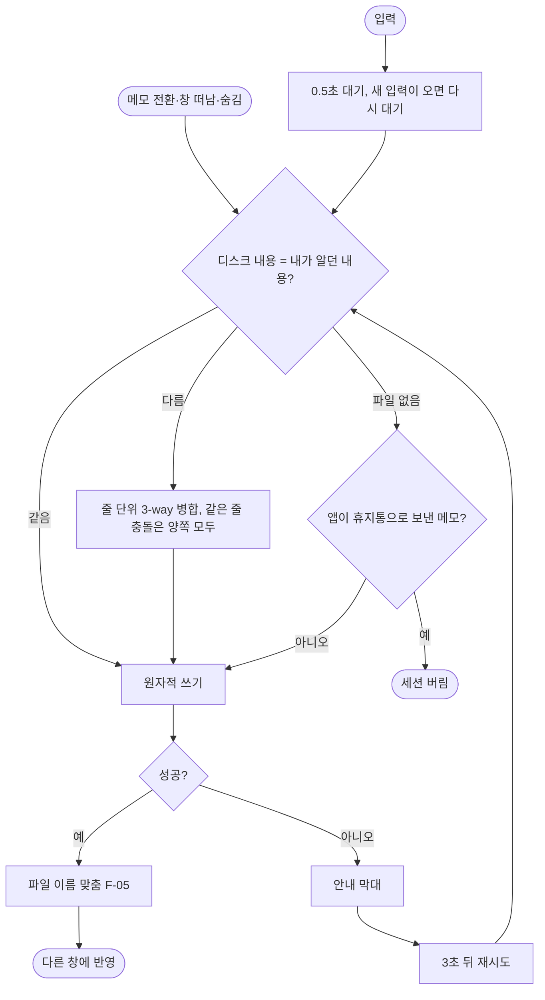
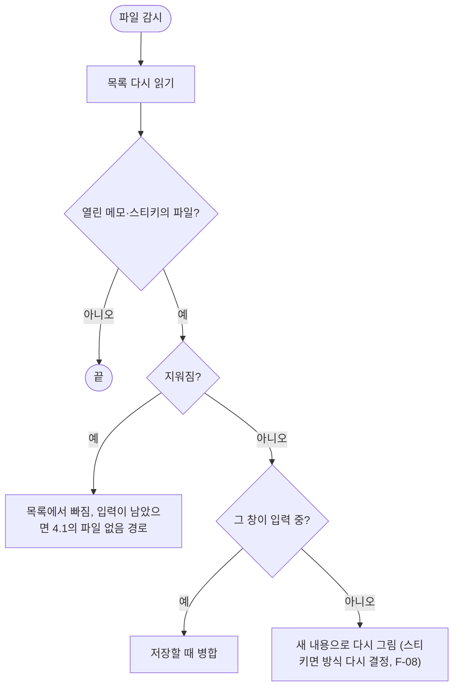

# F-07 저장·동기화

| 항목 | 내용 |
|---|---|
| 담당 | 기획 (검토: 디자인, 개발, QA) |
| 상태 | **확정** (2026-11-12, D-29) |
| 대상 버전 | v2.0 |
| 화면 | [프로토타입](../../prototype/index.html) (화면 없음. 안내 막대는 SCR-02-C) |

## 1. 왜
저장을 신경 쓰지 않는다. 스티키와 메인 창, 다른 앱에서 같은 메모를 고쳐도 입력이 사라지지 않는다(US-4, US-5). 공통 정책은 [Brief 3.2](../brief.md#32-저장충돌실패).

## 2. 요구사항
| ID | 약속 | MoSCoW | 수용 기준 | 검증 |
|---|---|---|---|---|
| FR-07 | 자동 저장 | Must | 입력을 멈추고 0.5초 뒤. 메모 전환·창 떠남·숨김·닫기 때 바로 | A1 |
| FR-22 | 다른 앱의 변경 반영 | Should | Finder·다른 편집기의 수정·삭제가 목록과 편집기에 반영. 입력 중에는 덮어쓰지 않고 병합 | A2 |
| (FR-30) | 두 창 동시 편집 | Must | 한쪽 입력이 1초 안에 다른 쪽에 보인다. 동시에 고치면 병합. 카드는 F-08 | A3 |
| (NFR-13) | 실패를 숨기지 않음 | Must | 안내 + 3초마다 재시도 | A4 |

## 3. 규칙
Brief 3.2의 1~6을 따른다. 이 카드에만 해당하는 것:

| # | 규칙 | 이유 |
|---|---|---|
| R-1 | 본문 쓰기와 파일 이름 맞추기는 따로 재시도한다 | 이름만 실패해도 본문은 저장(BUG-25) |
| R-2 | 저장 중 새로 친 입력도 상대 창 줄과 한 번 더 병합한다. 병합 결과는 입력 중이어도 다시 그린다 | BUG-39 |
| R-3 | 병합은 `ModoitCore`가 한다. 메인(TipTap)과 스티키(네이티브)가 섞여도 같은 규칙 | v2 |
| R-4 | 한글 조합 중에는 다시 그리기를 조합이 끝난 뒤로 미룬다 | NFR-20 |

## 4. 동작
### 4.1 저장

### 4.2 다른 앱의 변경

## 5. 검증
| ID | 무엇을 | 어디서 |
|---|---|---|
| A1 | 원자적 쓰기, 세션 수명 | Rust `atomic_write_replaces_and_leaves_no_tmp`, `src/qa/v03Session.test.ts` "release()" |
| A2 | 입력 중 외부 변경, 파일 감시 | `src/qa/sticky.test.tsx` BUG-05, v2 `ModoitKitTests` `FR22_watcher_reports_external_change`, `FR22_disk_change_matches_path_across_normalization` |
| A3 | 병합 | `src/qa/v03Session.test.ts` mergeBodies, "NoteSession 병합 저장", `src/qa/appRace.test.tsx` FR-30 |
| A4 | 실패 알림·재시도, 사라진 파일 | `src/qa/appRace.test.tsx` NFR-13 / BUG-22, `src/qa/v03Fix.test.tsx` BUG-40 |
| M1 | 두 창 번갈아 빠르게 입력(한글 포함) | 수동 G-7, G-14 |
