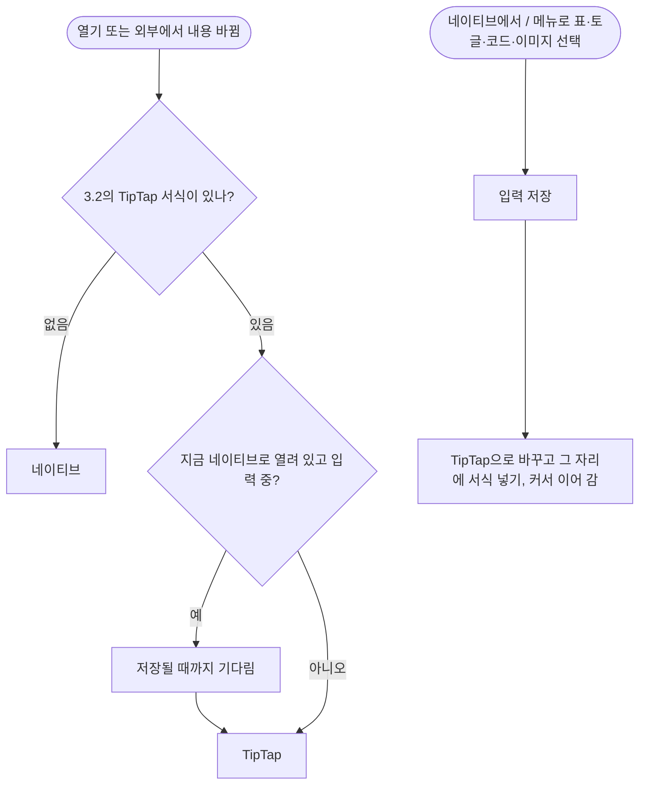

# F-08 스티키

| 항목 | 내용 |
|---|---|
| 담당 | 기획 (검토: 디자인, 개발, QA) |
| 상태 | **초안** |
| 대상 버전 | v2.0 |
| 관련 결정 | [D-04, D-12, D-21](../../decisions.md) |
| 화면 | [프로토타입](../../prototype/index.html) SCR-03(네이티브), SCR-04(TipTap) |

> **검토 요청**
> - **디자인:** 두 방식의 스티키가 똑같이 보여야 한다(R-6). 프로토타입에서 확인
> - **개발:** 규칙 R-11(열려 있는 동안 TipTap → 네이티브로 바꾸지 않음)을 구현할 수 있는지

## 1. 왜
- **문제:** 스티키 10개면 메모리가 약 1.4 GB다. 스티키마다 편집 화면이 통째로 하나씩 뜨기 때문이다(스파이크 측정).
- **사용자 가치:** 할 일 메모를 몇 장이든 바탕화면에 붙여 두고, 다른 앱 위에서 바로 체크한다. 개수를 신경 쓰지 않는다.
- **유저 스토리:** 할 일 메모 5~10개를 스티키로 붙여 두고 하루 종일 체크하고 싶다(US-1). 같은 메모를 스티키와 메인 창에서 번갈아 고쳐도 양쪽 입력이 남았으면 한다(US-4).

## 2. 요구사항
| ID | 약속 | MoSCoW | 수용 기준 | 검증 |
|---|---|---|---|---|
| FR-30 | 메모를 스티키로 꺼낸다 | Must | 편집기 툴바, 목록 우클릭, ⌘⇧S. 메인 창과 스티키가 **같은 파일**을 편집하고, 한쪽 입력이 1초 안에 다른 쪽에 보인다 | A1, A2 |
| FR-31 | 다시 넣고, 다시 꺼내면 같은 자리 | Must | ✕로 넣는다. 색·위치·크기를 기억한다. 사이드바 "스티키 메모"(v0.x "꺼내 둔 메모")와 색 점은 떠 있는 스티키만 | A3, M1 |
| FR-38 | 빠른 스티키 메모 | Should | ⌘⇧N으로 새 메모를 만들고 바로 스티키로 띄운다 | A4 |
| FR-40 | 플로팅 패널 | Must | 다른 앱의 포커스를 뺏지 않는다. 모든 데스크톱·전체 화면 앱 위. 핀을 누르면 항상 위 | M2 |
| FR-44 | 메인 창에서 넣기·기억 지우기 | Must | ⌘⇧S·툴바는 꺼내기↔넣기 토글. 우클릭 "다시 넣기", "색·위치 기억 지우기" | A3, A5 |
| FR-55 | 사이드바에서 항상 위 고정 **(v2 신규)** | Must | 사이드바 "스티키 메모"의 행마다 오른쪽에 핀 아이콘. 누르면 그 스티키의 항상 위가 켜지고 꺼진다(켜지면 채워진 핀). 스티키 막대의 핀과 같은 상태다 | A8(신규), M1 |
| FR-51 | 네이티브 편집기 **(v2 신규)** | Must | 3.2의 네이티브 서식을 그리고 편집한다. 단축 입력 결과가 메인 편집기와 같다. 고친 줄만 다시 쓴다 | A6(신규), M3 |
| FR-52 | 어려운 서식은 TipTap **(v2 신규)** | Must | 3.2의 TipTap 서식(표, 토글, 코드 블록, 이미지 등)이 있으면 TipTap 편집기로 연다. 사용자가 고르지 않는다. 겉모습이 같다 | A7(신규), M4 |
| NFR-17 | 가볍다 **(v2 신규)** | Must | 스티키 10개 + 메인 창 300 MB 이하, 스티키 1개당 20 MB 이하(표·토글 없는 메모 기준) | P1 |

## 3. 규칙

### 3.1 규칙과 이유
| # | 규칙 | 이유 |
|---|---|---|
| R-1 | 스티키는 별도 문서가 아니라 **메모를 바탕화면에 꺼낸 상태**다 | 같은 내용을 두 곳에서 관리하지 않는다(v0.2 결정) |
| R-2 | 스티키 정보(색, x, y, w, h, 항상 위, 열림)는 그 메모 파일의 frontmatter `sticky`에 저장한다 | 파일을 옮기거나 이름을 바꿔도 따라간다 |
| R-3 | 넣어도 색·위치·크기는 기억한다. "색·위치 기억 지우기"를 해야 지운다 | 다시 꺼내면 같은 자리에 |
| R-4 | 처음 꺼내면 노랑, 기본 위치, 280×280. 색은 노랑·분홍·파랑·초록·보라 | |
| R-5 | 저장하지 못한 입력이 있으면 넣지(닫지) 않는다 | 입력 보호 |
| R-6 | 두 방식(네이티브, TipTap)은 색·막대·버튼·글꼴·여백이 같다. 방식을 사용자에게 드러내지 않는다 | 사용자는 "스티키" 하나만 안다 |
| R-7 | ⌘⇧N으로 만든 스티키를 빈 채로 닫을 때만 그 메모를 휴지통으로 보낸다 | 원래 있던 메모를 지우지 않는다(BUG-23) |
| R-8 | 실행할 때 열려 있던 스티키를 복원한다. 연결된 모니터 밖이면 기본 위치로 | |
| R-9 | 네이티브 편집기는 사용자가 고친 줄만 다시 쓴다. frontmatter는 건드리지 않는다 | 두 편집기가 번갈아 써도 고치지 않은 부분은 그대로 |
| R-10 | 메모에 TipTap 서식이 **하나라도** 있으면 TipTap으로 연다 | 기능을 빠뜨리지 않는다 |
| R-11 | 열려 있는 동안 TipTap → 네이티브로는 바꾸지 않는다. 네이티브 → TipTap은 입력이 저장된 뒤에만 | 입력 중에 화면이 바뀌면 혼란스럽다 |
| R-12 | 한글 조합 중에는 저장·병합·화면 갱신이 조합을 끊지 않는다 | 글자 꼬임 방지(NFR-20) |

### 3.2 편집기 방식의 경계
| 서식 | 방식 | 상태 |
|---|---|---|
| 문단, 제목 1~3 | 네이티브 | 확정(D-04) |
| 점·번호 목록, 체크박스(중첩 포함) | 네이티브 | 확정 |
| 굵게, 기울임 | 네이티브 | 확정 |
| 인용, 구분선, 링크, 인라인 코드, 취소선 | 네이티브 | 확정(D-12) |
| 코드 블록 | TipTap | 확정(D-12) |
| 표, 토글 | TipTap | 확정 |
| 이미지 | TipTap | 확정(D-12) |
| 읽기 전용 대상(지원하지 않는 HTML 등) | TipTap(읽기 전용 안내 포함) | 확정 |

## 4. 동작

### 4.1 꺼내기·넣기

### 4.2 편집기 방식 결정

### 4.3 패널
- 막대 버튼: 핀(항상 위), 메인 창에서 열기, ✕(넣기). 비활성 패널에서도 항상 보인다. 색 견본은 마우스를 올릴 때만.
- 옮기거나 크기를 바꾸면 움직임이 멈춘 뒤 한 번 x·y·w·h를 저장한다.
- ⌘⇧S(꺼내기·넣기)와 ⌘⇧P(즐겨찾기, F-04)는 **메인 창에서 고른 메모**에 적용된다(스티키에 포커스가 있어도).
- "고정"은 항상 위만 뜻한다. 스티키를 넣으면 항상 위 설정은 기억하고(R-3), 즐겨찾기는 바뀌지 않는다(F-04 R-6).

### 4.4 예외
| 상황 | 동작 |
|---|---|
| 메모를 휴지통으로 보냄 | 스티키를 저장 없이 닫는다 |
| 저장 폴더를 바꿈 | 모든 스티키를 저장 후 닫는다 |
| 파일이 다른 앱에서 지워짐 | 입력이 남아 있으면 그 자리에 다시 만든다(F-07) |
| 같은 메모를 메인과 함께 편집 | 줄 단위 3-way 병합, 같은 줄 충돌은 양쪽 모두 남김(F-07) |
| 앱 종료 | 스티키도 저장을 마친 뒤 종료(F-12) |

## 5. 검증
| ID | 무엇을 | 어디서 |
|---|---|---|
| A0 | 화면 밖 위치 거부 | Rust `offscreen_positions_are_rejected` |
| A1 | 두 창 번갈아 편집, 입력 유실 없음 | `src/qa/appRace.test.tsx` "FR-30 같은 메모를 두 창에서 편집" |
| A2 | 제목 입력 직후 꺼내기 | `src/qa/appRace.test.tsx` BUG-28 |
| A3 | 메인 창에서 넣기, 응답 없는 스티키 | `src/qa/v03App.test.tsx` "BUG-38 / FR-44", `src/qa/v03Fix.test.tsx` BUG-42·48·49 |
| A4 | ⌘⇧N 빈 스티키만 정리 | `src/qa/sticky.test.tsx` BUG-23, `src/qa/v03App.test.tsx` "⌘⇧N만 fresh" |
| A5 | 기억 지우기는 sticky 키만 | `src/qa/sticky.test.tsx` FR-44 |
| A6 | 네이티브: 단축 입력 결과 = 메인 편집기, 고친 줄만 다시 씀 | **신규 작성 필요** (Swift) |
| A7 | 방식 결정·전환 규칙 R-10, R-11 | **신규 작성 필요** (Swift) |
| A8 | 사이드바 핀과 스티키 막대 핀이 같은 상태 | **신규 작성 필요** (Swift) |
| M1 | 넣고 꺼내기 반복, 목록·색 점 | 수동 (v0.3 G-11) |
| M2 | 다른 앱 앞에서 포커스, Spaces·전체 화면 | 수동 (v0.2 M-9) |
| M3 | 한글 입력 G-14 시나리오 (네이티브) | 수동 |
| M4 | 두 방식의 겉모습 비교 | 수동 (프로토타입 → 실제 앱) |
| P1 | 메모리 | `spike/bench.sh` 방식 |

v0.3 자동 테스트(A1~A5)는 v2에서 Swift로 옮길 명세다. 테스트 이름의 ID를 그대로 유지한다.
