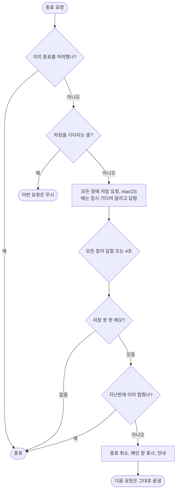

# F-12 종료

| 항목 | 내용 |
|---|---|
| 담당 | 기획 (검토: 디자인, 개발, QA) |
| 상태 | **검토 중** (프로토타입 검토 때 화면과 함께 확정, D-22) |
| 대상 버전 | v2.0 |
| 화면 | [프로토타입](../../prototype/index.html) (화면 없음. 안내는 SCR-02) |

## 1. 왜
입력 직후 앱을 끄거나 로그아웃해도 마지막 글자까지 남아야 한다(US-7, BUG-35).

## 2. 요구사항
| ID | 약속 | MoSCoW | 수용 기준 | 검증 |
|---|---|---|---|---|
| NFR-13 (종료) | 모든 종료 경로에서 저장 후 종료 | Must | ⌘Q, Dock "종료", 로그아웃·재시동·시스템 종료, AppleScript `quit`이 모두 아래 4장 절차를 따른다 | A1, M1 |

## 3. 규칙
| # | 규칙 | 이유 |
|---|---|---|
| R-1 | 모든 창이 남은 입력을 저장했다고 알려야 종료한다. 응답 없는 창은 최대 4초 | 로그아웃을 오래 막지 않는다 |
| R-2 | 저장 못 한 메모가 있으면 **한 번** 멈추고 안내한다. 다음 종료 요청은 그대로 끝낸다 | 디스크 고장 등으로 영영 못 끄는 일을 막는다 |
| R-3 | 메인 창 빨간 버튼은 종료가 아니다(F-02) | |
| R-4 | 강제 종료·전원 차단·충돌은 막을 수 없다. 0.5초 저장 대기 중이던 입력이 사라질 수 있다. 매뉴얼에 적는다 | |

## 4. 동작

- 안내 문구: "저장하지 못한 메모 N개가 있어 종료를 멈췄습니다. 한 번 더 종료하면 저장하지 않고 끝냅니다." (10초)
- v0.4(Tauri)는 `src-tauri/src/quit.rs`에 구현했다. v2는 앱 delegate의 `applicationShouldTerminate`로 같은 절차를 만든다.

## 5. 검증
| ID | 무엇을 | 어디서 |
|---|---|---|
| A1 | 창의 저장 후 응답, 실패 수 보고, 안내 | `src/qa/quit.test.tsx` |
| M1 | 실제 앱: Dock 종료, ⌘Q(한글), 스티키, 로그아웃, 저장 실패 시 멈춤 | [수동 확인 목록](../../qa/manual-checks.md) BUG-35 |
